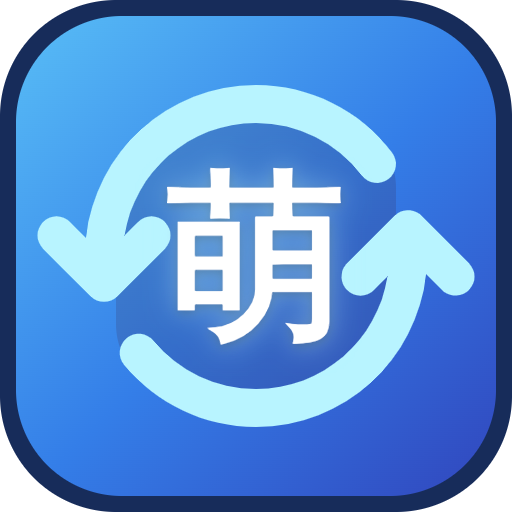

<div align="center">
  
  <h1>MoeSync</h1>
  <p><strong>Tus listas de anime y manga, en un solo lugar.</strong></p>
  <p>Organiza tu biblioteca, compara servicios y sincroniza cambios desde una sola aplicación Flutter.</p>
  <p><strong>Desarrollada principalmente para Android, Windows y Linux.</strong></p>
  <p><a href="../README.md">English</a> · <a href="README.pl.md">Polski</a></p>
</div>

---

## Descripción

MoeSync reúne servicios de seguimiento de anime y manga en una biblioteca unificada. Explora tus listas, elige las fuentes de información, revisa las diferencias entre servicios y decide qué cambios sincronizar.

## Funciones

- **Biblioteca unificada** — consulta en un solo lugar el anime y el manga de tus servicios conectados.
- **Sincronización entre servicios** — compara las listas con un servicio principal, revisa las adiciones y actualizaciones pendientes y aplica los cambios que elijas.
- **Fuentes de información flexibles** — configura por separado las fuentes predeterminadas de información, descripciones y sincronización para anime y manga.
- **Detalles de los títulos** — consulta descripciones, puntuaciones, clasificaciones, estadísticas, títulos relacionados, recomendaciones, equipo, personajes y, si están disponibles, temas musicales del anime.
- **Visualización personalizada** — elige entre cuadrícula y lista, selecciona un tema y configura por separado el idioma de la aplicación y el de los títulos mostrados.
- **Caché local de la biblioteca** — conserva las listas cargadas entre actualizaciones.

## Servicios compatibles

| Servicio | Anime | Manga |
| --- | :---: | :---: |
| MyAnimeList | ✓ | ✓ |
| AniList | ✓ | ✓ |
| Kitsu | ✓ | ✓ |
| Shikimori | ✓ | ✓ |
| Simkl | ✓ | — |
| MangaBaka | — | ✓ |
| MangaUpdates | — | ✓ |

Las funciones pueden variar. La disponibilidad de títulos, descripciones, metadatos y operaciones de cuenta depende de cada servicio y de su API.

## Descargas

Descarga las versiones disponibles de MoeSync desde [GitHub Releases](https://github.com/THR3ATB3AR/moesync/releases). Los lanzamientos están destinados principalmente a **Android, Windows y Linux**.

## Primeros pasos

### Requisitos

- Flutter SDK y una versión de Dart compatible con la restricción indicada en [`pubspec.yaml`](../pubspec.yaml)
- Un entorno de desarrollo de Android, Windows o Linux configurado para Flutter

### Ejecutar o compilar una versión release localmente

```bash
git clone https://github.com/THR3ATB3AR/moesync.git
cd moesync
flutter pub get
flutter run --release --dart-define-from-file=.env
```

Antes de ejecutar el comando, crea y configura localmente el archivo `.env` necesario. No lo subas al repositorio ni compartas credenciales, claves de API o secretos.

El comando ejecuta la aplicación en modo release en el dispositivo o destino Flutter seleccionado. Flutter debe estar configurado para la plataforma elegida.

Conecta tus servicios en **Ajustes → Seguimiento y cuentas**. Puedes elegir las fuentes predeterminadas de información para anime y manga en **Ajustes → Fuentes de datos y sincronización**.

### Plataformas compatibles

MoeSync se desarrolla principalmente para **Android, Windows y Linux**. Los demás destinos de Flutter no son prioritarios y pueden tener compatibilidad limitada o no estar disponibles.

## Idiomas

La interfaz de MoeSync está disponible en inglés, polaco y español. El idioma de la aplicación puede seguir el idioma del sistema o configurarse de forma independiente. Para los títulos mostrados se puede preferir el título de origen, el inglés, el japonés o el rōmaji. Si un servicio no ofrece el título elegido, MoeSync utiliza otro título disponible.

## Desarrollo

Los recursos de localización de Flutter están en [`lib/l10n/`](../lib/l10n/). Después de editar los archivos ARB, genera las clases de localización con:

```bash
flutter gen-l10n
```

Ejecuta el análisis estático y las pruebas con:

```bash
flutter analyze
flutter test
```

## Datos y proveedores de servicios

MoeSync se conecta a servicios de terceros en tu nombre. Cada proveedor gestiona la disponibilidad, las API y las condiciones de uso de su servicio. La aplicación guarda localmente las credenciales de las cuentas y las preferencias. No añadas credenciales personales, secretos de API ni tokens al control de versiones.

## Licencia

El código fuente original de MoeSync está sujeto a la licencia **GNU GPL-3.0-or-later**. El texto de la GPL versión 3 está en [`LICENSE`](../LICENSE), y el aviso que permite usar esta versión o cualquier posterior está en [`COPYRIGHT`](../COPYRIGHT). Los paquetes y las imágenes de terceros conservan sus propias licencias; puedes consultar las licencias de los paquetes en **Ajustes → Acerca de → Licencias de código abierto**. [`THIRD_PARTY_NOTICES.md`](../THIRD_PARTY_NOTICES.md) recoge la información identificada sobre ilustraciones y logotipos de servicios.
